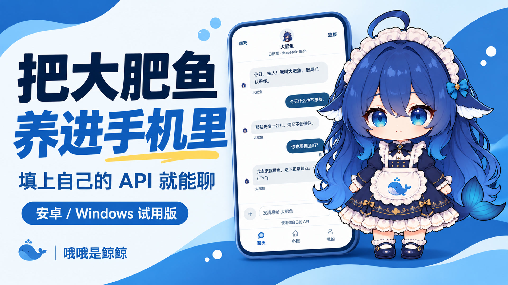

# 大肥鱼小屋 · OO Fish Hut

把大肥鱼 OO 养进手机和电脑里。你可以和她聊天，给她起个称呼，让小屋用上你喜欢的背景。Windows 版还可以把她放在桌面上。

[下载公开试用版](https://github.com/Ori3570/oo-fish-hut/releases/tag/v2026.11.22) · 制作与发布 [哦哦是鲸鲸](https://space.bilibili.com/3747574804646987)

## 下载和安装

| 平台 | 安装包 | 可以体验 |
| --- | --- | --- |
| Android 7 及以上 | [安卓 APK 0.2.3-a1](https://github.com/Ori3570/oo-fish-hut/releases/download/v2026.11.22/oo-fish-hut-android-0.2.3-a1.apk) | 聊天、性格与记忆、相册聊天背景、记录导出和 B 站工作台 |
| Windows 10/11 64 位 | [Windows 0.7.1 纯净聊天版](https://github.com/Ori3570/oo-fish-hut/releases/download/v2026.11.22/oo-fish-hut-windows-0.7.1-clean-x64.zip) | 聊天、桌面宠物、称呼和人格、自定义图标与背景、可选的主动搭话 |

1. **安卓**。把 APK 下载到手机，在文件管理里点开安装。如果系统询问，按系统提示为当前下载或文件管理应用授权。相同包名和同一签名的旧版本可以覆盖安装。卸载或清除应用数据前，请先导出想保留的聊天。
2. **Windows**。先完整解压 ZIP，再双击「大肥鱼小屋.exe」。运行时目录 `_internal` 和许可目录 `licenses` 要和 EXE 放在一起。Python 与 Qt 运行库已经随包带齐。 EXE 为未签名试用构建，系统如果提示来源，请先用下方校验值确认文件完整。
3. **连接模型**。按应用内的提示填写自己的 API Key。安卓可在「我的」里打开 API 配置，Windows 用「连接设置」。使用其他兼容模型服务时，按服务商给出的 Chat Completions 兼容地址、模型名和 Key 填写。安卓连接地址使用 HTTPS。

程序免费试用。模型用量由你填写的 API 服务商计费。界面和默认素材随安装包提供，模型聊天需要联网。

## 用起来

- **隐私**。使用者从初始配置开始。Key 在自己的设备上加密保存。发送消息时，请求和所需对话上下文传给你配置的模型服务。可从设置清除凭据，安卓支持导出聊天记录。
- **桌面宠物**。Windows 公开版专注聊天与桌宠。主动搭话默认关闭，开启后会使用你配置的模型 API。
- **安卓 B 站工作台**。可以用目标视频与文字材料起草评论，也可用工作台预览纯文字动态。直接提交需要本人登录确认，扫码连接限当前会话。发布前请看清账号与正文。
- **安卓 QQ 与微信**。QQ 入口可打开你填写的官方机器人资料卡，消息回复需要另有运行中的机器人。「连接微信」提供扫码操作指引，实际接收由另行配置的桌面主版负责。手机端的表情包与自拍入口目前显示为暂未开启。

连接失败时，先检查 API 地址、模型名和 Key 是否属于同一家服务。反馈时可以附上系统、版本和复现步骤，把 Key、账号凭据和私聊内容从截图里遮掉。

## 版本状态与来源

Windows 包已在独立数据目录完成离线启动和基础界面检查。安卓 APK 已检查签名与内置文件，真机运行、付费模型调用及 B 站真实提交待试用核验。

Windows 安装包附有[对应源码](https://github.com/Ori3570/oo-fish-hut/releases/download/v2026.11.22/oo-fish-hut-windows-0.7.1-clean-source.zip)。两个安装包及源码包的校验值见 [SHA256SUMS.txt](SHA256SUMS.txt)。可以用 Windows 的 `Get-FileHash -Algorithm SHA256 -LiteralPath <文件>` 核对。

人物素材沿用有许可记录的暗蓝鲸鱼娘资产，程序保留原有署名。运行库、素材、许可证与 Qt 对应源码入口详见[来源与第三方许可](docs/THIRD-PARTY.md)。
