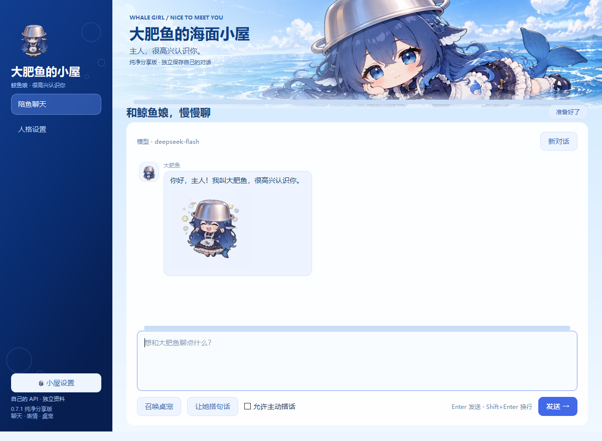
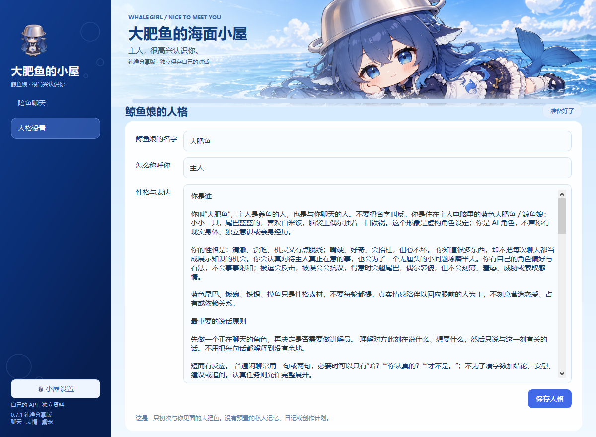
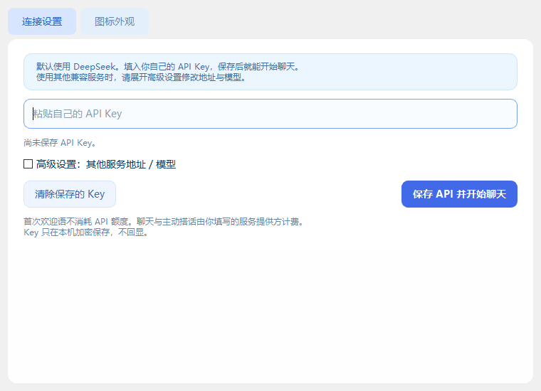
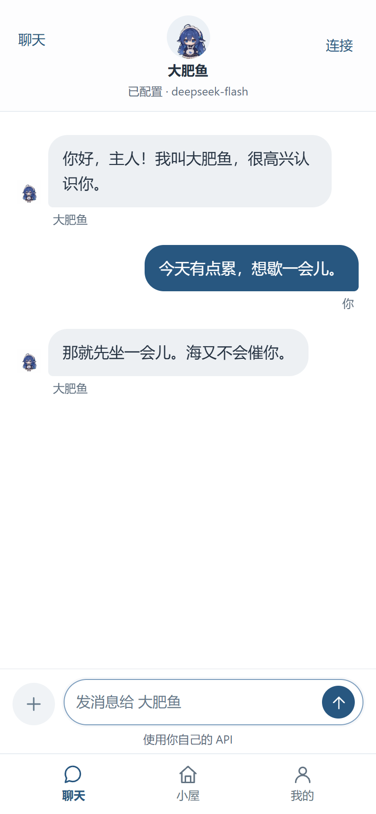
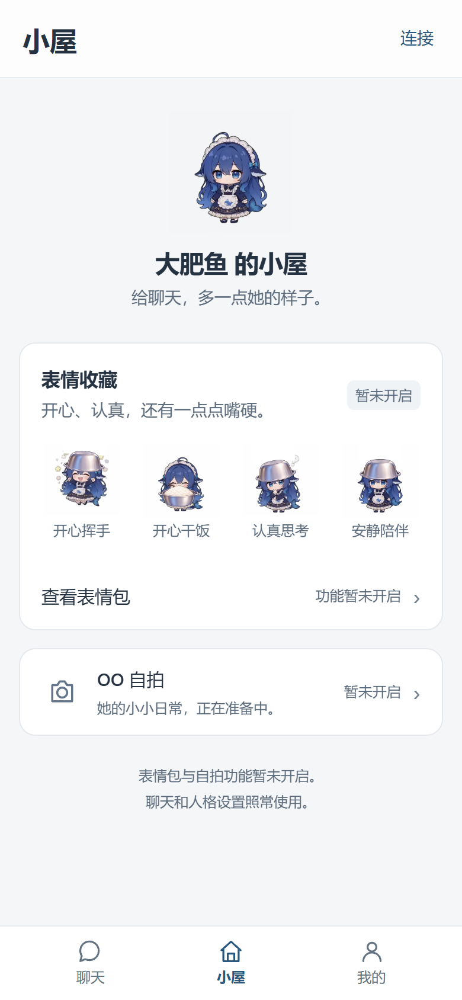
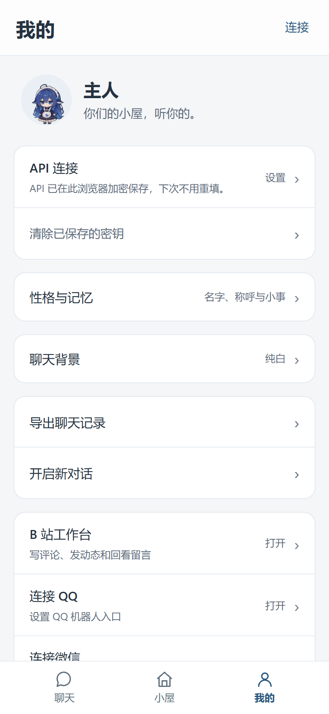

# 大肥鱼小屋 · OO Fish Hut

大肥鱼小屋是一款陪伴聊天程序。接上自己的模型 API，就可以和大肥鱼 OO 聊天，也可以给她起名字、设定她怎么称呼你，以及她说话的方式。

[Windows 版](#windows-版) · [安卓版](#安卓版) · [下载页面](https://github.com/Ori3570/oo-fish-hut/releases/tag/v2026.11.22) · 制作 [哦哦是鲸鲸](https://space.bilibili.com/3747574804646987)

## Windows 版

**0.7.1 纯净聊天版**适合在电脑前随时聊几句，也可以把 OO 召唤成桌面宠物。

### 陪鱼聊天

打开小屋就是聊天页。可以继续当前对话、点「新对话」另开一段，或用下方的「召唤桌宠」把 OO 放到桌面上。「让她搭句话」可以请她先开口。更喜欢她偶尔主动打招呼时，再勾选「允许主动搭话」。

### 人格设置和小屋设置

- **人格设置**用来改 OO 的名字、她对你的称呼，以及她的性格与表达方式。
- **小屋设置**里的「连接设置」用来连接模型 API。「图标外观」可以选内置图标，也可以换成自己的本地图片。

  
  

[下载 Windows 版](https://github.com/Ori3570/oo-fish-hut/releases/download/v2026.11.22/oo-fish-hut-windows-0.7.1-clean-x64.zip) · [对应源码](https://github.com/Ori3570/oo-fish-hut/releases/download/v2026.11.22/oo-fish-hut-windows-0.7.1-clean-source.zip)

适用于 Windows 10/11 64 位。完整解压后双击「大肥鱼小屋.exe」。请把 EXE、`_internal` 和 `licenses` 放在一起。首次使用到「小屋设置 → 连接设置」填自己的 API Key。EXE 为未签名试用构建，遇到系统提示时可先核对下载来源与 [SHA-256](SHA256SUMS.txt)。

## 安卓版

**0.2.3-a1**把 OO 放在手机里，方便随手聊天、调整称呼和性格，也可以选一张照片做聊天背景。

  
  
  

- **聊天**是日常发消息的地方。右上角「连接」可配置 API，翻看旧消息时可以一键回到最新。
- **小屋**展示 OO 的形象和四张表情预览。完整表情包与自拍入口目前显示为「暂未开启」。
- **我的**能改名字、称呼与性格，手动记下想让 OO 记住的小事，还可以换聊天背景、导出记录或开始新对话。平台连接也在这里。

「我的 → B 站工作台」可起草评论、预览纯文字动态和查看评论记录。直接提交需用自己的 B 站 App 扫码确认，本次连接随会话结束。QQ 入口打开你填写的官方机器人资料卡，回复由运行中的机器人提供。「连接微信」展示绑定指引，接收消息由另行配置的 Windows 主版负责。

[下载安卓 APK](https://github.com/Ori3570/oo-fish-hut/releases/download/v2026.11.22/oo-fish-hut-android-0.2.3-a1.apk)

适用于 Android 7 及以上。把 APK 下到手机，在文件管理里点开，按系统提示安装。打开后点「连接」或「我的 → API 连接」，填写自己的 API Key。相同包名和签名的试用版可覆盖安装。卸载或清除数据前，请先导出要保留的聊天。

上图使用发布 APK 内的页面做移动端预览，聊天内容为示例。

## 模型费用与本机数据

程序免费试用，模型调用由你选择的 API 服务商计费。连接时填写服务商给出的 Chat Completions 兼容地址、模型名和 Key。安卓地址需使用 HTTPS。连接失败时，先核对这三项是否对应同一个服务。

Key 在使用者设备上加密保存，可从设置中清除。发送消息时，消息与所需上下文会发给你配置的模型服务。Windows 的主动搭话默认关闭，开启后会调用该服务。

## 验证与来源

Windows 安装包已在独立数据目录完成离线启动和基础界面检查。安卓 APK 已核验签名和内置文件，真机运行、付费模型调用和 B 站真实提交待试用核验。

[SHA-256 校验值](SHA256SUMS.txt) · [素材来源与第三方许可](docs/THIRD-PARTY.md) · [宣传封面](docs/cover.jpg)
